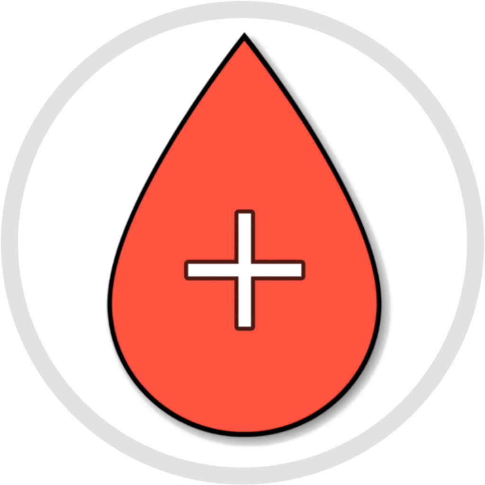

<p align="center">
  
</p>

<h1 align="center">W8BDCR Blood Box</h1>

<p align="center">Find blood donors in Bangladesh — donate blood and save a life.</p>

<p align="center">
  <a href="https://github.com/w8bdcr-official"></a>
  <a href="https://github.com/w8bdcr-official/W8BDCR-blood-box"></a>
  <a href="https://github.com/w8bdcr-official/W8BDCR-blood-box/fork"></a>
  <a href="https://github.com/w8bdcr-official/W8BDCR-blood-box/blob/main/LICENSE"></a>
</p>

---

## About

W8BDCR Blood Box is an app to find blood donors in Bangladesh. People from any region can create an account and log in. When you need blood, you can find a blood donor from this app.

## Features

- **Online, shared donor registry** — a donor registered on one phone appears on every phone that installs the app. The registry lives in Firebase Realtime Database (Google's servers), so it stays up even when any single server is down.
- **Online, shared blood requests** — a request posted on one phone appears on every phone. Requests live in the same Firebase database (`/requests` node), with urgent matching requests shown in the বার্তা tab for your blood group.
- Find blood donors anywhere in Bangladesh — search by blood group (8 groups, dropdown) and district (all 64 districts) + thana (dropdown per district, with "অন্যান্য" free text)
- Home screen with a rotating banner ("জীবন বাঁচাতে" / "আজই রক্ত দিন"), recent blood requests, 3 quick actions, and a big "new blood request" button
- Hospital directory — 118 verified hospitals in all 64 districts (name + district + area + type: government / medical college / private; no phone numbers), searchable by name + district; pick one straight from the new-request form, or type a hospital not in the list — works offline
- Blood requests — post a request (patient, bags needed, hospital, date, urgent) and share it; delete your own request (local + online)
- বার্তা tab — urgent online requests matching your blood group, plus your own requests with their online status (direct chat is not in this version — donors are reached by the call button)
- Create an account and log in by phone number — log in on another phone and your donor entry is found from the online list
- Register as a donor: name, email, blood group, district, phone number, last donation date — with a donor on/off switch and a password (min 8 characters, eye-icon show/hide)
- Tap-to-call a donor straight from the search results (opens the dialer)
- Side drawer with info pages (About, Terms, Privacy, Medical disclaimer, Account deletion guide, FAQ)
- Bangla UI, red theme, 5-tab bottom navigation

> Demo donors in the app are sample data only — clearly marked "ডেমো", with no real phone number and no working call button. Real donors you register appear separately, above the demo list.

## Online registry — how it works

The app talks to Firebase Realtime Database at `https://w8bdcr-gate-default-rtdb.firebaseio.com` with plain REST — no secret, no auth, no account needed. Donors live at `/donors`, blood requests at `/requests`. Only public donor/request info is stored there (name, phone, blood group, district, thana, last donation date, hospital, patient, bags needed, consent flag). **Passwords never leave your phone** — they stay in the app's local storage only.

If the online list cannot be reached (no internet, or the server is down), the app honestly says so and shows the donors/requests registered on your own phone plus the demo list — it never pretends the online list loaded when it did not.

Direct in-app messaging is not built yet — donors are reached by the call button.

## Download

Get the latest APK (v3.0): [W8BDCR-BloodBox-v3.0.apk](https://w8bdcr.de5.net/W8BDCR-BloodBox-v3.0.apk)

## Install

1. Download the APK above onto your Android phone.
2. Open the APK and tap **Install** (allow "Install unknown apps" for your browser/file manager if asked).
3. Open **W8BDCR Blood Box** and register as a donor, or search for one.

## Build from source

Requirements: JDK 17 and the Android build tools (`aapt2`, `d8`, `apksigner`, `zipalign`) plus an Android SDK `android.jar` (API 28) and the W8BDCR signing keystore.

```bash
bash build.sh
```

The signed APK is written to `build/W8BDCR-BloodBox-v3.0.apk`. `build.sh` looks for `android-28.jar` in the project root first, then in the shared build-tools location.

## Project Structure

```
W8BDCR-blood-box/
├── .assets/
│   └── logo.png
├── assets/
│   └── index.html        # Bangla UI (home / donors / requests / hospitals / messages / profile / register)
├── res/
│   └── drawable/
│       └── icon.png      # App icon (from logo.png)
├── src/
│   └── com/w8bdcr/bloodbox/
│       └── MainActivity.java   # WebView shell + W8Native bridge (dial, toast, HTTP, share)
├── AndroidManifest.xml
├── build.sh
├── .gitignore
├── LICENSE
└── README.md
```

## Contributing

Contributions are welcome. Open an issue or submit a pull request — all changes are reviewed before merging.

## License

MIT — see [LICENSE](LICENSE). Copyright (c) 2022 W8BDCR.

## Support

Star the repo ⭐ and message us on Telegram: [@W8BDCR](https://t.me/W8BDCR)
